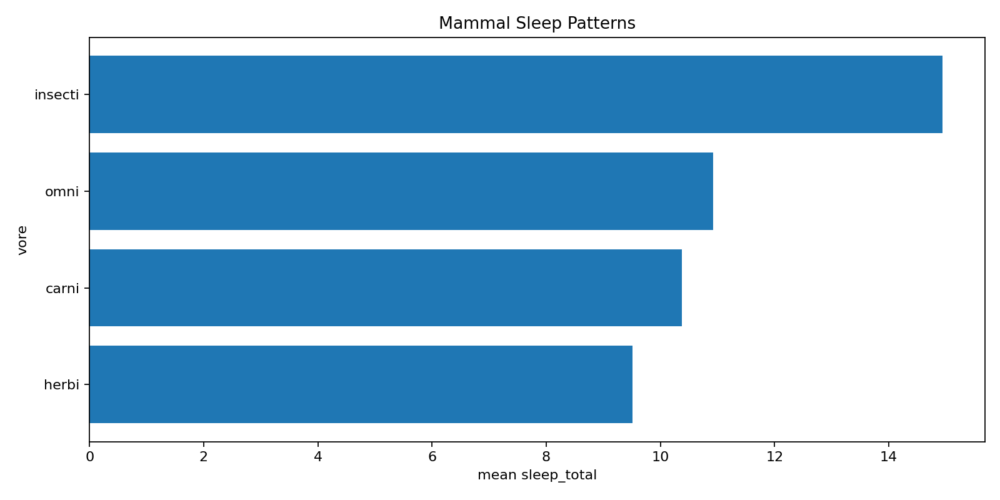

# Mammal Sleep Patterns — executed results

## Decision question
How does recorded sleep differ by feeding category?

## Evidence
The largest observed mean sleep_total is 14.940 for insecti. This ranking is descriptive, not a recommendation.

Raw rows: 83. Rows used: 76. Excluded for missing/nonfinite required values or invalid denominator: 7.

## Method
Complete-case descriptive comparison of sleep_total by vore; show group counts, mean, minimum and maximum.

## Interpretation and limitations
Species are not independent random samples; missing feeding labels are excluded. No causal inference, significance claim or production deployment is implied. Missing values are not imputed; identical rows are retained. Small or repeated samples limit uncertainty interpretation.

## Recommended next decision
Check sample sizes and phylogenetic dependence before scientific inference.

## Reproducibility
Source and exact downloaded-byte SHA256 are recorded in run_manifest.json. SQL results are in answer.csv and analysis.sqlite. Review quality_audit.csv before interpretation.
